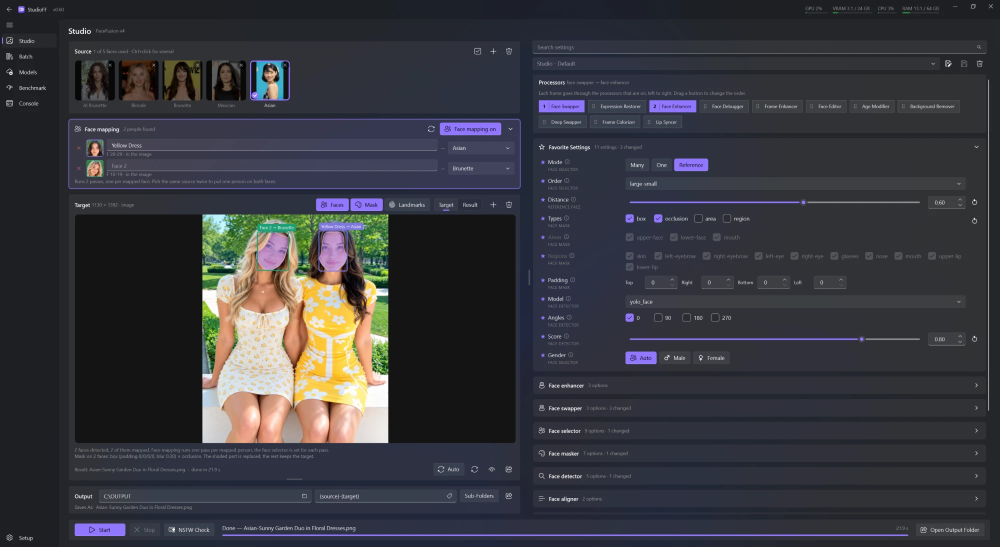
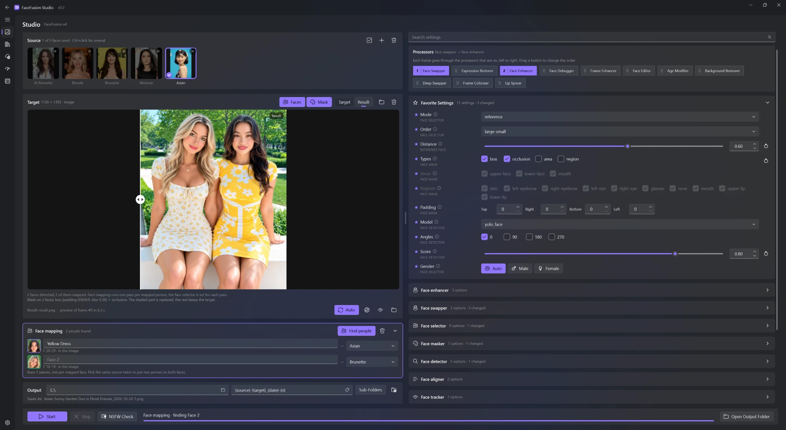
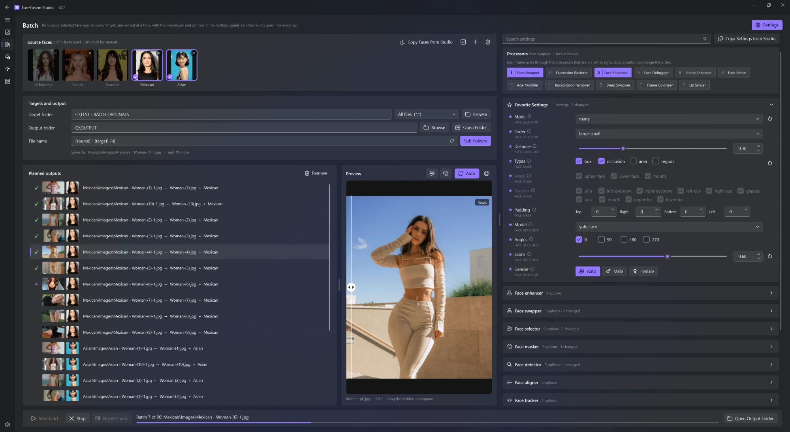
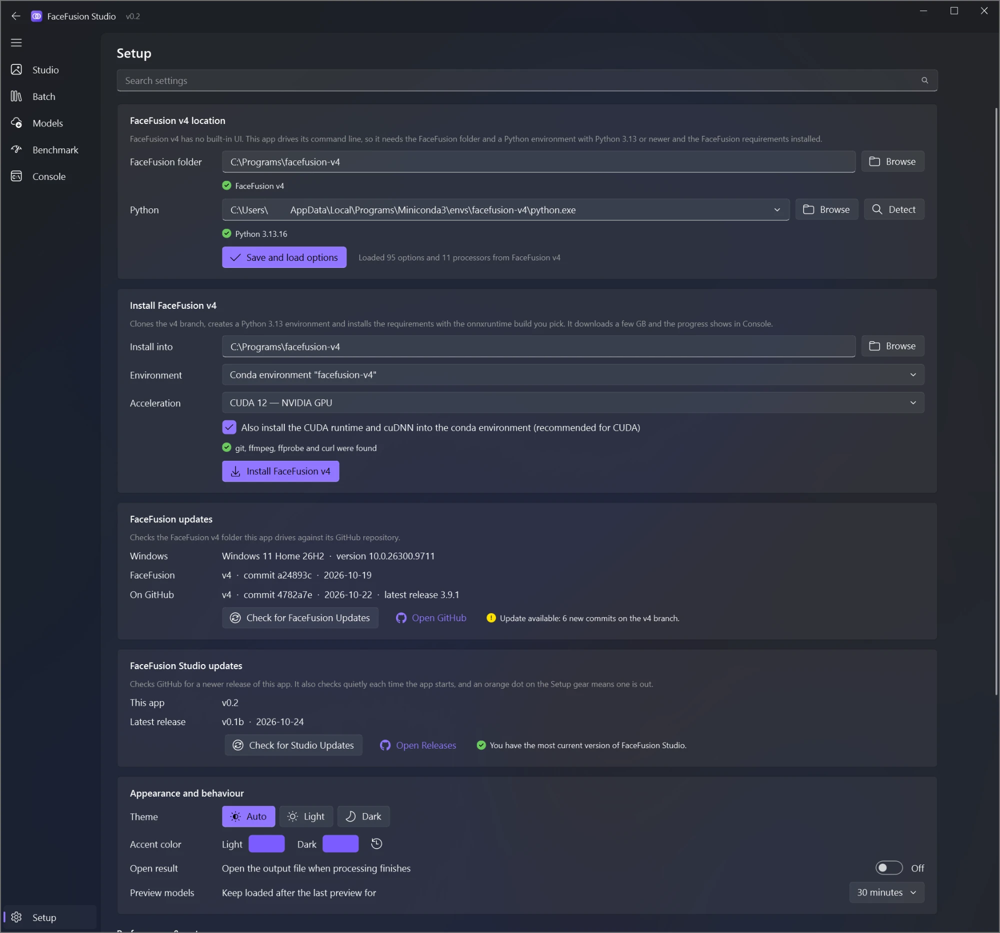

# FaceFusion Studio

A native Windows 11 desktop UI for [FaceFusion v4](https://github.com/facefusion/facefusion/tree/v4).

FaceFusion v4 has no built-in UI, only a command line and an API server. FaceFusion Studio drives the
`facefusion.py` command line for you: you pick sources, a target and processors, it builds the command,
runs it in FaceFusion's own Python environment and shows progress and the result.

FaceFusion itself is not included: install FaceFusion v4 separately, then point FaceFusion Studio at it.

## Screenshots

| Before | After |
| --- | --- |
|  |  |
| **Batch** | **Setup** |
|  |  |

## Features

- **Studio**: drop in source faces and a target image, video or GIF, turn on processors and drag them into order. The preview tries your settings on one frame (automatically with **Auto**), and **Start** runs the full job. Models stay loaded between previews, so after the first one each takes about 2 seconds.
- **Batch**: every source face × every target in a folder, with its own settings (or copied from Studio in one click). Each planned output shows thumbnails and can be removed, a live preview tries the selected one, and one failed target doesn't stop the rest.
- **Face mapping**: give each person in the target their own source face. Two people can even swap faces with each other.
- **GIF support**: GIF targets are converted for FaceFusion and saved back as looping GIFs (needs `ffmpeg`).
- **Output names**: build file names from tags like `{source}`, `{target}`, `{date}` and `{n}`, with an optional sub-folder per source.
- **Favorite Settings and search**: star any setting to pin it to Favorite Settings, or filter all settings with *Search settings*. Open or closed setting groups stay that way.
- **Faces**: shows the faces FaceFusion detects in the current frame and which ones will be processed. If none will be, it says why.
- **Mask**: shades the face mask FaceFusion will blend through, and redraws as you change mask settings.
- **Models**: download the lite or full model set, see what's installed, and delete models to free space.
- **Benchmark**: runs FaceFusion's benchmark on your hardware and exports the results as a shareable image.
- **Setup**: point the app at an existing FaceFusion v4 or install it from scratch, and check GitHub for FaceFusion updates. An orange dot on the Setup gear means a new FaceFusion Studio release is out, and **Update to vX** installs it and reopens the app, keeping your settings, presets and FaceFusion.
- **Custom look**: Auto, Light or Dark theme, with your own accent color for each (one click puts back the standard purple).
- **Fluent design**: Windows 11 style throughout, a splash screen with a loading bar, and settings remembered between runs.

## Install

```powershell
powershell -ExecutionPolicy Bypass -File install.ps1
```

This creates `.venv` for the UI (PySide6 + PySide6-Fluent-Widgets + OpenCV) and adds desktop and Start menu
shortcuts. Then start **FaceFusion Studio** and open **Setup**. A splash screen with a loading bar shows while
the window builds, and starting it again while it is open brings the open window to the front:

- **Already have v4?** Pick its folder and the `python.exe` of its environment, or press **Detect**, then press **Save and load options**.
- **No v4 yet?** Use **Install FaceFusion v4**. Note that v4 requires **Python 3.13+**, so a
  FaceFusion 3.x environment (Python 3.12) can't run it.

FaceFusion also needs `ffmpeg`, `ffprobe` and `curl` on `PATH`. Setup checks for them.

## Layout

| Path | Purpose |
| --- | --- |
| `ffstudio/schema_dump.py` | Runs inside the FaceFusion environment and dumps the `run` options as JSON |
| `ffstudio/schema.py` | Loads that schema, resolves model-dependent choices, builds CLI flags |
| `ffstudio/output_name.py` | File name tags (`{target}`, `{source}`, `{n}` …) and the output path they build |
| `ffstudio/runner.py` | `QProcess` wrapper that parses FaceFusion's progress bar output |
| `ffstudio/session.py` | Shared state: config, schema, option values, runner |
| `ffstudio/benchmark_report.py` | Draws the exported benchmark image (hardware, settings, results) |
| `ffstudio/gif_run.py` | Runs inside the FaceFusion environment: GIF → video → FaceFusion → GIF |
| `ffstudio/content_check.py` | Runs inside the FaceFusion environment: FaceFusion's NSFW filter on targets, without processing |
| `ffstudio/nsfw.py` | NSFW messages, the red bar and the flagged-frames window |
| `ffstudio/face_probe.py` | Runs inside the FaceFusion environment and stays running: the faces found in a frame, which would be processed, and their face mask |
| `ffstudio/faces.py` | Talks to `face_probe.py` and words its results |
| `ffstudio/pages/*` | Studio, Batch, Models, Benchmark, Console, Setup |

App data (settings, cached schema, preview frames) lives in `%APPDATA%\FaceFusionStudio`. The preview
folder only ever holds the latest frame and result (overwritten each time) and is deleted when the app
closes. After **Stop** or a failed run, FaceFusion's temp folder for this machine is cleared too.
Set `FFSTUDIO_DATA_DIR` to use a different folder.

## License

Released into the public domain under [The Unlicense](UNLICENSE). FaceFusion has its own license.
