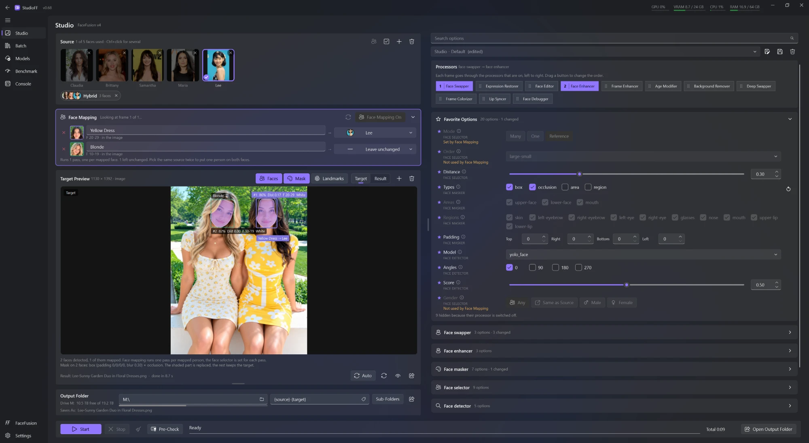
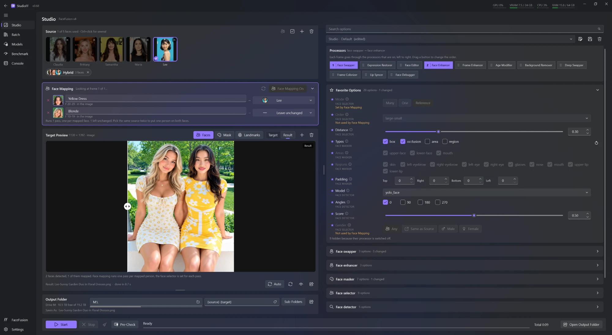
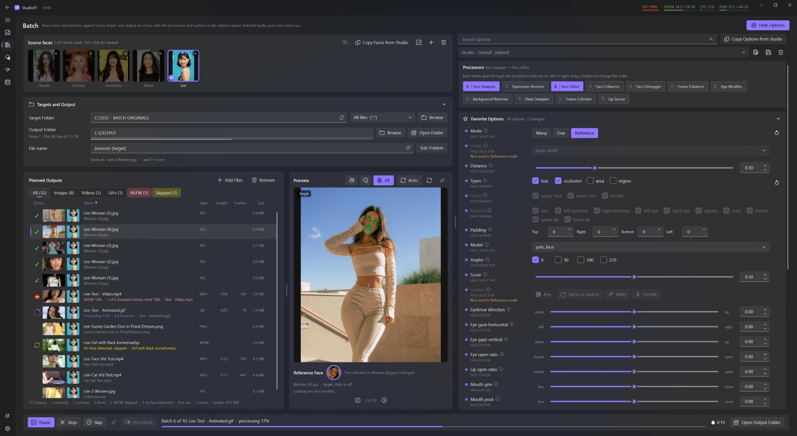
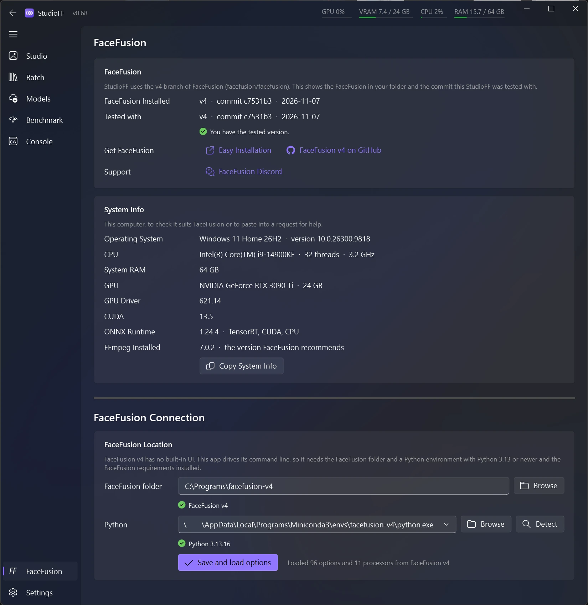

# StudioFF

A desktop app for the [FaceFusion v4](https://github.com/facefusion/facefusion/tree/v4) face swapper. Not made or endorsed by the FaceFusion team.

StudioFF swaps faces in images, videos and GIFs. Pick the faces to use, pick a target, preview
the swap on one frame and run it, one target at a time or a whole folder in a batch. Several people in one
target can each get a different face.

It is a Windows 11 desktop app for FaceFusion v4, which has no built-in UI of its own, only a command line.
StudioFF builds the command for you, runs it in FaceFusion's own Python environment and shows
progress and the result.

FaceFusion itself is not included: install FaceFusion v4 separately, then point StudioFF at it.

## Screenshots

| Before | After |
| --- | --- |
|  |  |
| **Batch** | **Settings** |
|  |  |

## Features

- **Studio**: swap faces in one target. Drop in source faces and a target image, video or GIF, turn on processors and drag them into order. The preview tries your settings on one frame (automatically with **Auto**), and **Start** runs the full job. Models stay loaded between previews, so after the first one each takes about 2 seconds. The Settings page's **Preview models** setting picks how long they stay loaded after the last preview (5 minutes by default), and Start and Benchmark free them first. Batch keeps them loaded from one output to the next, so each file after the first starts sooner.
- **Batch**: every source face × every target in a folder, with its own options (or copied from Studio in one click). Each planned output shows thumbnails and can be removed (removed outputs stay out after a restart until you restore them). A live preview tries the selected one, on the frame you pick for a video (remembered after a restart), and one failed target doesn't stop the rest. While a batch runs, Run Batch turns into **Pause**: the output being made freezes in place and goes on from the same frame on **Resume**, and the broom button beside Skip frees its memory instead, so Resume makes that one output again from the start. Copy Options from Studio asks first when it would replace options that differ.
- **Face mapping**: give each person in the target their own source face. Two people can even swap faces with each other. Works on images, videos, GIFs and animated WebPs.
- **GIF support**: GIF targets are converted for FaceFusion and saved back as looping GIFs (needs `ffmpeg`).
- **AVIF and HEIC support**: AVIF and HEIC (iPhone) images work as sources and targets. StudioFF uses a PNG copy of each one, so the result is a PNG.
- **More file types**: JFIF images run as a JPG copy. FLV and F4V (Flash) videos are moved into an MKV copy, so the result is an MKV. MPG and MPEG videos work as they are.
- **Animated WebP support**: animated WebP targets run as a lossless video copy and are saved back as looping animated WebPs. Transparent parts turn white.
- **Output names**: build file names from tags like `{source}`, `{target}`, `{date}` and `{n}`, with an optional sub-folder per source.
- **Favorite Options and search**: star any option to pin it to Favorite Options, or filter all options with *Search options*. Open or closed option groups stay that way.
- **Faces**: shows the faces FaceFusion detects in the current frame and which ones will be processed. If none will be, it says why.
- **Mask**: shades the face mask FaceFusion will blend through, and redraws as you change mask settings.
- **Models**: download the lite or full model set, see what's installed, and delete models to free space.
- **Benchmark**: runs FaceFusion's benchmark on your hardware and exports the results as a shareable image.
- **FaceFusion**: point the app at an existing FaceFusion v4 or install it from scratch, and check GitHub for FaceFusion updates. It shows whether your FaceFusion is the version StudioFF was tested with, and can switch to that version, to the latest one or back again.
- **System monitor**: graphics card, processor and memory use in the title bar, read with FaceFusion's own libraries. A bar under each reading goes from green to orange to red as it fills. It can be turned off in Settings.
- **Custom look**: Auto, Light or Dark theme, with your own accent color for each (one click puts back the standard purple).
- **Fluent design**: Windows 11 style throughout, a splash screen with a loading bar, and settings remembered between runs.

## Install

Pick the section for your system. Every way needs an internet connection and a few GB of free space for FaceFusion and its models.

> **Tested on Windows 11**, both the Windows install and Pinokio (with an NVIDIA card). Linux and macOS, with or without
> Pinokio, are **experimental and untested**: the scripts are written, but StudioFF has not been run there yet. Please
> report what happens in an [issue](https://github.com/Icey321/StudioFF/issues).

### Windows 11

1. Download the latest release from the [Releases page](https://github.com/Icey321/StudioFF/releases) and unzip it to a folder
   of your choice, for example `C:\Programs\StudioFF`.
2. In that folder, right-click an empty spot, choose **Open in Terminal** and run:

   ```powershell
   powershell -ExecutionPolicy Bypass -File install.ps1
   ```

   This creates `.venv` for the app (PySide6, PySide6-Fluent-Widgets, OpenCV) and adds **StudioFF** shortcuts to the desktop
   and the Start menu. If the PC has neither Python 3.10+ nor [uv](https://docs.astral.sh/uv/), it explains what it would
   install and asks first; on yes it installs uv through winget, and uv downloads Python 3.12 for StudioFF only.
3. Start **StudioFF**. The first time, it opens the **FaceFusion** page:
   - **Already have FaceFusion v4?** The app looks for it in the usual places (next to the StudioFF folder, your user folder,
     Documents, Desktop, Downloads, the top of each local drive and Pinokio's apps) and fills in the folder and its Python.
     Check them, or pick them yourself with **Browse** and **Detect**, then press **Save and load options**.
   - **No FaceFusion v4 yet?** Press **Install FaceFusion v4** on the same page. It lists any missing program it needs (Git, uv,
     FFmpeg, curl) and installs them through winget only after you agree. uv downloads Python 3.13 itself, so you don't have
     to install Python. FaceFusion v4 needs **Python 3.13 or newer**, so a FaceFusion 3.x environment (Python 3.12) can't run it.

StudioFF updates itself from **Settings** when a new release is out.

### Pinokio (Windows tested; Linux and macOS experimental, untested)

[Pinokio](https://pinokio.computer) installs everything for you, FaceFusion v4 included.

1. Install Pinokio and open it.
2. Click **Create** (or **Create App**), open the **Download** tab, paste `https://github.com/Icey321/StudioFF` into
   **Git URL** and press **Import**.
3. Press **Install** in StudioFF's menu, then **Install** again on the next page.
   - Windows may ask whether Python, Git for Windows and uv may access the internet. Allow each one.
   - If Pinokio lists programs it needs to install or update first (such as CUDA and Python), press **Install** there too.

   It installs StudioFF with its own FaceFusion v4 (CUDA on an NVIDIA card, DirectML on other Windows graphics cards,
   otherwise CPU) inside the Pinokio app folder. This downloads several GB and takes a while. Its settings stay apart from
   any other StudioFF on the same computer.
4. When Pinokio says StudioFF is installed, press **Start** to open the StudioFF window.

Update StudioFF with Pinokio's **Update** button. FaceFusion is updated from StudioFF's **FaceFusion** page as usual.

### Linux and macOS (without Pinokio) - experimental, untested

StudioFF is made and tested on Windows. The Linux support comes from
[tokenwizard's Linux fork](https://github.com/tokenwizard/StudioFF), tested there on CachyOS with an NVIDIA card, but this
version has not been run on Linux yet. macOS has never been tried on a real computer.

1. Install Python 3.12 or newer, Git, FFmpeg and curl with your package manager (`apt`, `dnf`, `pacman` or `brew`), and
   conda or [uv](https://docs.astral.sh/uv/) for FaceFusion's own environment.
2. Get the code and run the installer, which sets up the app's environment and, on Linux, adds StudioFF to your app launcher:

   ```bash
   git clone https://github.com/Icey321/StudioFF.git
   cd StudioFF
   ./install.sh
   ```

3. Start **StudioFF** from the app launcher, or run `./StudioFF.sh`.
4. On the **FaceFusion** page, press **Install FaceFusion v4**, or pick a FaceFusion v4 you installed yourself (its folder
   and the `bin/python` of its Python 3.13 environment). Without an NVIDIA card, Linux offers MIGraphX for AMD cards
   (ROCm must be set up first) or CPU only.

Update with `git pull` in the StudioFF folder.

## Layout

| Path | Purpose |
| --- | --- |
| `ffstudio/schema_dump.py` | Runs inside the FaceFusion environment and dumps the `run` options as JSON |
| `ffstudio/schema.py` | Loads that schema, resolves model-dependent choices, builds CLI flags |
| `ffstudio/output_name.py` | File name tags (`{target}`, `{source}`, `{n}` …) and the output path they build |
| `ffstudio/runner.py` | `QProcess` wrapper that parses FaceFusion's progress bar output |
| `ffstudio/session.py` | Shared state: config, schema, option values, runner |
| `ffstudio/benchmark_report.py` | Draws the exported benchmark image (hardware, settings, results) |
| `ffstudio/gif_run.py` | Runs inside the FaceFusion environment: GIF → video → FaceFusion → GIF, or a video copy → FaceFusion → animated WebP; `--finish` does only the last step after face mapping's passes |
| `ffstudio/content_check.py` | Runs inside the FaceFusion environment: FaceFusion's NSFW filter on targets, without processing |
| `ffstudio/nsfw.py` | NSFW messages, the red bar and the flagged-frames window |
| `ffstudio/face_probe.py` | Runs inside the FaceFusion environment and stays running: the faces found in a frame, which would be processed, and their face mask |
| `ffstudio/faces.py` | Talks to `face_probe.py` and words its results |
| `ffstudio/system_monitor.py` | Runs inside the FaceFusion environment and stays running: graphics card, processor and memory use once a second |
| `ffstudio/monitor.py` | Talks to `system_monitor.py` and shows its numbers in the title bar |
| `ffstudio/pages/*` | Studio, Batch, Models, Benchmark, Console, FaceFusion and Settings |

App data (settings, cached schema, preview frames) lives in `%APPDATA%\StudioFF` on Windows, `~/.config/StudioFF` on Linux
and `~/Library/Application Support/StudioFF` on macOS (versions before v0.40 used `%APPDATA%\FaceFusionStudio`,
which is moved over on the first start). The preview
folder only ever holds the latest frame and result (overwritten each time) and is deleted when the app
closes. After **Stop** or a failed run, FaceFusion's temp folder for this machine is cleared too.
Set `FFSTUDIO_DATA_DIR` to use a different folder.

## Thanks

- [tokenwizard](https://github.com/tokenwizard) made StudioFF run on Linux in [a fork](https://github.com/tokenwizard/StudioFF)
  and tested it there. Those fixes are in this version: the CUDA library paths FaceFusion needs on Linux, `install.sh` and
  `StudioFF.sh` with the app launcher entry, Open Folder in Linux file managers, Linux paths colored in the Console, the system font
  and MIGraphX for AMD cards.

## AI tools used

Most of the code was written with [Claude Code](https://claude.com/claude-code) (Anthropic's Claude
models), working from my requests and feedback. Changes were tested in the app before each release.
No other AI tools were used.

## License

Released under the [MIT License](LICENSE). FaceFusion has its own license (OpenRAIL-AS).
