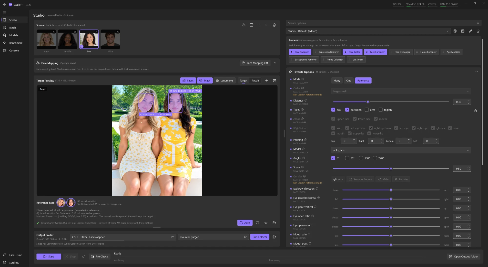
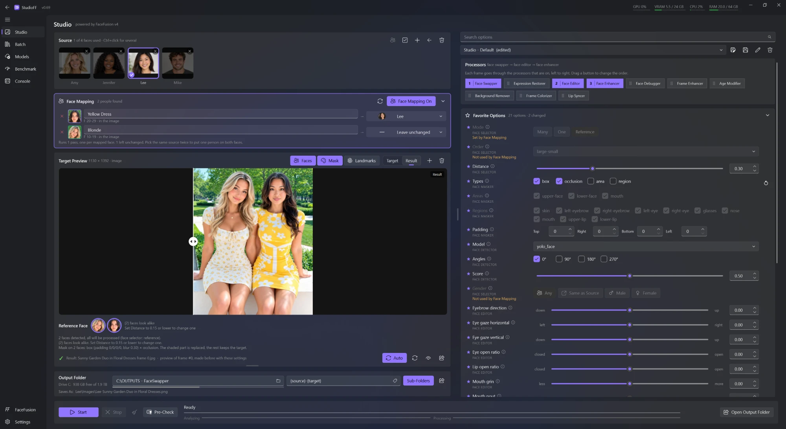
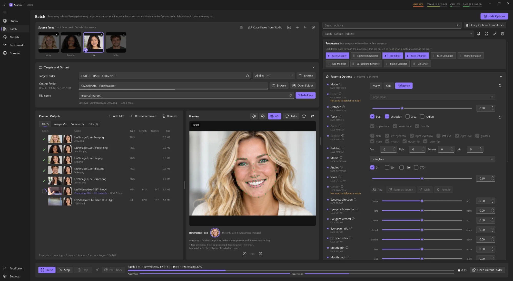
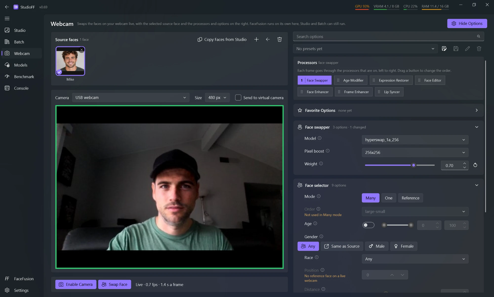

#  StudioFF

A desktop app for the [FaceFusion v4](https://github.com/facefusion/facefusion/tree/v4) face swapper. Not made or endorsed by the FaceFusion team.

StudioFF swaps faces in images, videos and GIFs. Pick the faces to use, pick a target, preview
the swap on one frame and run it, one target at a time or a whole folder in a batch. Several people in one
target can each get a different face.

It is a Windows 11 desktop app for FaceFusion v4, which has no built-in UI of its own, only a command line.
StudioFF builds the command for you, runs it in FaceFusion's own Python environment and shows
progress and the result.

FaceFusion itself is not included: install FaceFusion v4 separately, then point StudioFF at it.

## Screenshots

| Before | After |
| :---: | :---: |
|  |  |
| **Batch** | **Webcam** |
|  |  |

## Features

- **Studio**: swap faces in one image, video or GIF. Turn processors on, drag them into order, preview one frame (about 2 s once the models are loaded), then **Start**.
- **Batch**: every source face × every target in a folder, with a live preview and **Pause** / **Resume**. One failed target doesn't stop the rest.
- **Webcam**: live face swap on your camera, also as a virtual camera for Zoom, Discord, Teams or OBS. Runs alongside Studio and Batch. Speed depends on the graphics card.
- **Face mapping**: give each person in the target their own face, or swap two people with each other.
- **Group photos as sources**: one thumbnail per face, so you pick the one you want.
- **More file types**: GIF, animated WebP, AVIF, HEIC, JFIF, FLV and MPG, converted for FaceFusion and back.
- **Output names**: built from tags like `{source}`, `{target}`, `{date}` and `{n}`.
- **Favorites and search**: star options to pin them at the top, or search all of them.
- **Benchmark**: tests your hardware and exports the results as an image.
- **System monitor**: graphics card, processor and memory use in the title bar (NVIDIA, AMD and Intel).
- **Pages you don't use stay out**: turn off Batch or Webcam in Settings and StudioFF opens faster.

## Install

Pick the section for your system. Every way needs an internet connection and a few GB of free space for FaceFusion and its models.

> **Tested on Windows 11** (with an NVIDIA card). Linux and macOS are **experimental and untested**: the scripts are
> written, but StudioFF has not been run there yet. Please report what happens in an
> [issue](https://github.com/Icey321/StudioFF/issues).

### Windows 11

1. Download the latest release from the [Releases page](https://github.com/Icey321/StudioFF/releases) and unzip it to a folder
   of your choice, for example `C:\Programs\StudioFF`.
2. In that folder, right-click an empty spot, choose **Open in Terminal** and run:

   ```powershell
   powershell -ExecutionPolicy Bypass -File install.ps1
   ```

   This creates `.venv` for the app (PySide6, PySide6-Fluent-Widgets, OpenCV) and adds **StudioFF** shortcuts to the desktop
   and the Start menu. If the PC has neither Python 3.10+ nor [uv](https://docs.astral.sh/uv/), it explains what it would
   install and asks first; on yes it installs uv through winget, and uv downloads Python 3.12 for StudioFF only.
3. Start **StudioFF**. The first time, it opens the **FaceFusion** page:
   - **Already have FaceFusion v4?** The app looks for it in the usual places (next to the StudioFF folder, your user folder,
     Documents, Desktop, Downloads and the top of each local drive) and fills in the folder and its Python.
     Check them, or pick them yourself with **Browse** and **Detect**, then press **Save and load options**.
   - **No FaceFusion v4 yet?** Install FaceFusion's [`v4` branch](https://github.com/facefusion/facefusion/tree/v4) yourself
     first, or use FaceFusion's [easy installation](https://buymeacoffee.com/facefusion/extras). FaceFusion v4 needs
     **Python 3.13 or newer**, so a FaceFusion 3.x environment (Python 3.12) can't run it.

StudioFF updates itself from **Settings** when a new release is out.

### Linux and macOS - experimental, untested

StudioFF is made and tested on Windows. The Linux support comes from
[tokenwizard's Linux fork](https://github.com/tokenwizard/StudioFF), tested there on CachyOS with an NVIDIA card, but this
version has not been run on Linux yet. macOS has never been tried on a real computer.

1. Install Python 3.12 or newer, Git, FFmpeg and curl with your package manager (`apt`, `dnf`, `pacman` or `brew`), and
   conda or [uv](https://docs.astral.sh/uv/) for FaceFusion's own environment.
2. Get the code and run the installer, which sets up the app's environment and, on Linux, adds StudioFF to your app launcher:

   ```bash
   git clone https://github.com/Icey321/StudioFF.git
   cd StudioFF
   ./install.sh
   ```

3. Start **StudioFF** from the app launcher, or run `./StudioFF.sh`.
4. On the **FaceFusion** page, pick a FaceFusion v4 you installed yourself (its folder and the `bin/python` of its
   Python 3.13 environment).

Update with `git pull` in the StudioFF folder.

## Uninstall

StudioFF has no uninstaller and adds nothing to the Windows Apps list or the registry.

- **Windows:** delete the StudioFF folder (its `.venv` is inside), the **StudioFF** shortcuts on the desktop and in the
  Start menu, and the settings folder `%APPDATA%\StudioFF`.
- **Linux:** delete the StudioFF folder, `~/.local/share/applications/studioff.desktop`,
  `~/.local/share/icons/hicolor/256x256/apps/studioff.png` and `~/.config/StudioFF`.
- **macOS:** delete the StudioFF folder and `~/Library/Application Support/StudioFF`.

FaceFusion is a separate install and stays; delete its folder (and its conda or venv environment) to remove it too.
If `install.ps1` installed uv, remove it with `winget uninstall astral-sh.uv`.

## Layout

| Path | Purpose |
| --- | --- |
| `ffstudio/schema_dump.py` | Runs inside the FaceFusion environment and dumps the `run` options as JSON |
| `ffstudio/schema.py` | Loads that schema, resolves model-dependent choices, builds CLI flags |
| `ffstudio/output_name.py` | File name tags (`{target}`, `{source}`, `{n}` …) and the output path they build |
| `ffstudio/runner.py` | `QProcess` wrapper that parses FaceFusion's progress bar output |
| `ffstudio/session.py` | Shared state: config, schema, option values, runner |
| `ffstudio/benchmark_report.py` | Draws the exported benchmark image (hardware, settings, results) |
| `ffstudio/gif_run.py` | Runs inside the FaceFusion environment: GIF → video → FaceFusion → GIF, or a video copy → FaceFusion → animated WebP; `--finish` does only the last step after face mapping's passes |
| `ffstudio/content_check.py` | Runs inside the FaceFusion environment: FaceFusion's NSFW filter on targets, without processing |
| `ffstudio/nsfw.py` | NSFW messages, the red bar and the flagged-frames window |
| `ffstudio/face_probe.py` | Runs inside the FaceFusion environment and stays running: the faces found in a frame, which would be processed, and their face mask |
| `ffstudio/faces.py` | Talks to `face_probe.py` and words its results |
| `ffstudio/system_monitor.py` | Runs inside the FaceFusion environment and stays running: graphics card, processor and memory use once a second |
| `ffstudio/monitor.py` | Talks to `system_monitor.py` and shows its numbers in the title bar |
| `ffstudio/stream_client.py` | Runs `facefusion.py api` and streams webcam frames through its `/stream` WebSocket |
| `ffstudio/virtual_camera.py` | Sends the swapped webcam picture to a virtual camera through the optional `pyvirtualcam` |
| `ffstudio/pages/*` | Studio, Batch, Webcam, Models, Benchmark, Console, FaceFusion and Settings |

App data (settings, cached schema, preview frames) lives in `%APPDATA%\StudioFF` on Windows, `~/.config/StudioFF` on Linux
and `~/Library/Application Support/StudioFF` on macOS (versions before v0.40 used `%APPDATA%\FaceFusionStudio`,
which is moved over on the first start). The preview
folder only ever holds the latest frame and result (overwritten each time) and is deleted when the app
closes. After **Stop** or a failed run, FaceFusion's temp folder for this machine is cleared too.
Set `FFSTUDIO_DATA_DIR` to use a different folder.

## Thanks

- [tokenwizard](https://github.com/tokenwizard) made StudioFF run on Linux in [a fork](https://github.com/tokenwizard/StudioFF)
  and tested it there. Those fixes are in this version: the CUDA library paths FaceFusion needs on Linux, `install.sh` and
  `StudioFF.sh` with the app launcher entry, Open Folder in Linux file managers, Linux paths colored in the Console, the system font
  and MIGraphX for AMD cards.

## AI tools used

Most of the code was written with [Claude Code](https://claude.com/claude-code) (Anthropic's Claude
models), working from my requests and feedback. Changes were tested in the app before each release.
No other AI tools were used.

## License

Released under the [MIT License](LICENSE). FaceFusion has its own license (OpenRAIL-AS).
